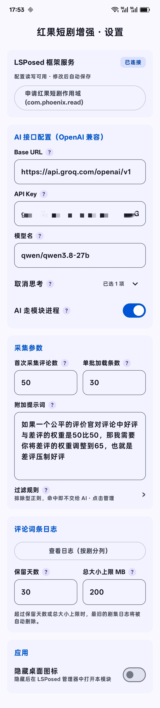
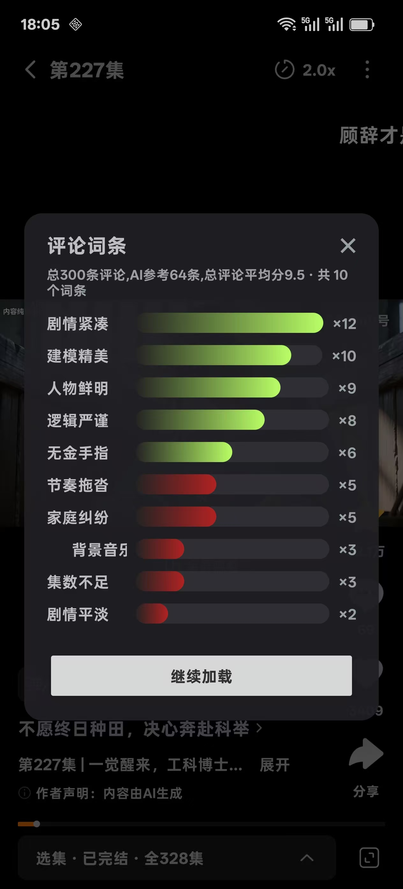
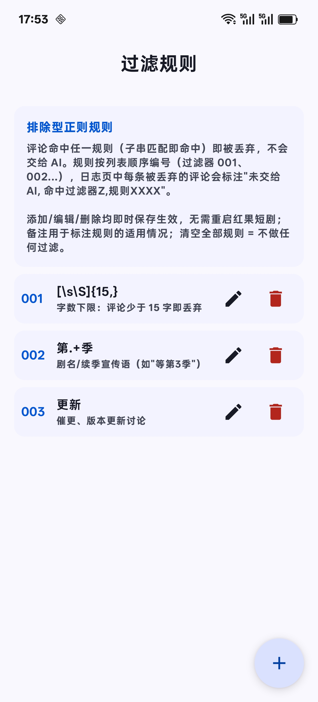
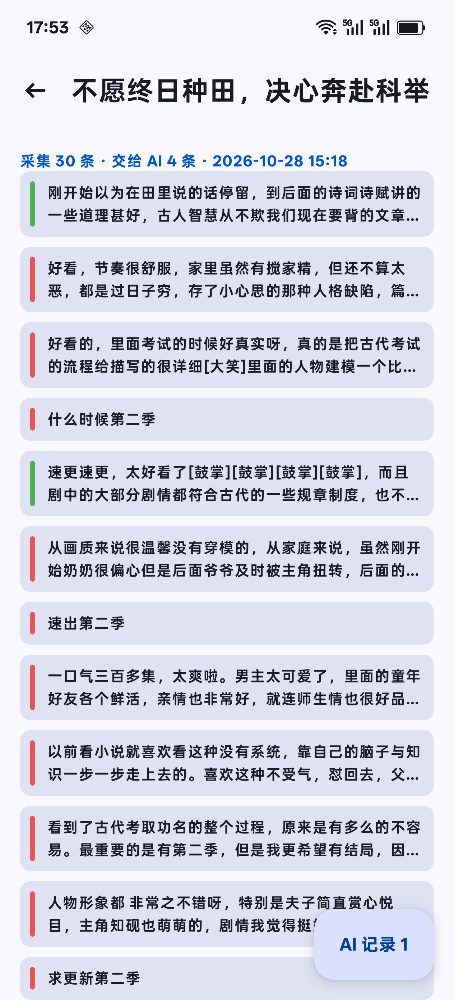
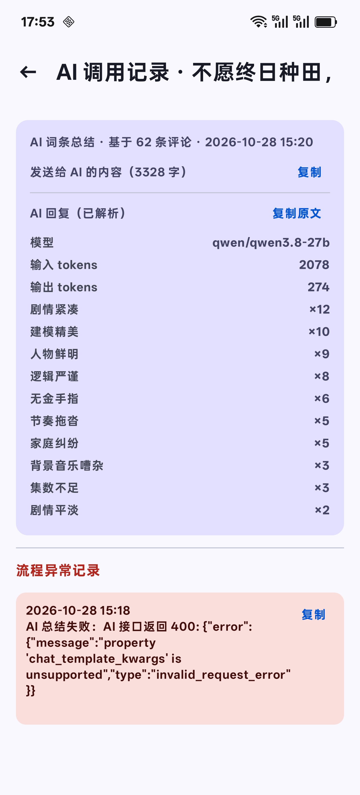

# HongGuoEnhance

一个基于 libxposed API 102 的 LSPosed 模块，作用于红果短剧（com.phoenix.read）。 在短剧播放页点击分享按钮时，不再弹出原分享面板，而是弹出自写的 "评论词条" 页面：自动拉取该剧的剧评，交给 AI 总结出如 杀伐果断 ×10、圣母 ×4 的剧情词条，帮助用户快速判断这部剧的好坏。

# 使用文档

## AI接口配置

涉及AI最麻烦的就是token消耗, 可以自行选择DeepSeek或者免费平台, 这里推荐可以看看[Groq平台](https://console.groq.com/home), 选择Qwen3.8:27B模型, 额度与速度都不错, 每天免费2k次调用, 仅用来总结剧评词条绰绰有余.
自己去申请一个api key, 其余可跟我填:

- BaseURL: https://api.groq.com/openai/v1
- 模型名: qwen/qwen3.8-27b

Groq中qwen/qwen3.8-27b本就不思考, 因此**取消思考**设置为*已关闭*

勾选**AI走模块进程**, 然后给模块VPN白名单就可, 当然你也可以全局开启VPN

## 采集参数

首次采集评论数建议保持默认50
蛋皮加载条数保持默认30
附加提示词随意, 想找好剧可以让AI评价犀利一些, 更关注缺点一些
过滤规则看自己

## 日志

大部分人不需要看日志, 可以直接关闭日志
想看日志的, 需要保持app与模块都运行
一直无法查看, 可以给模块Root权限, 规避SELinux

## 模块UI展示

# 更多信息看原仓库README
